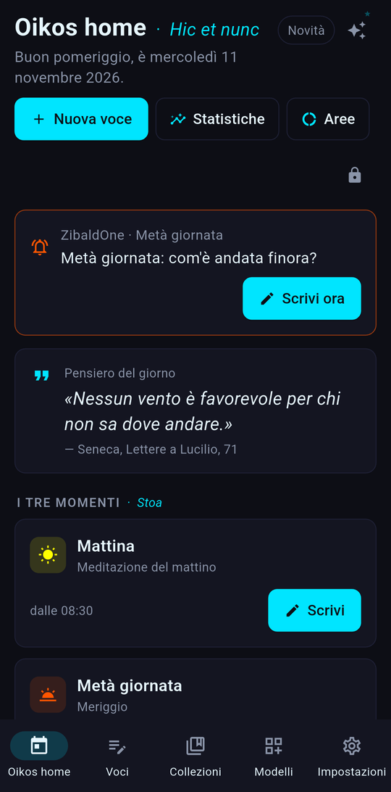
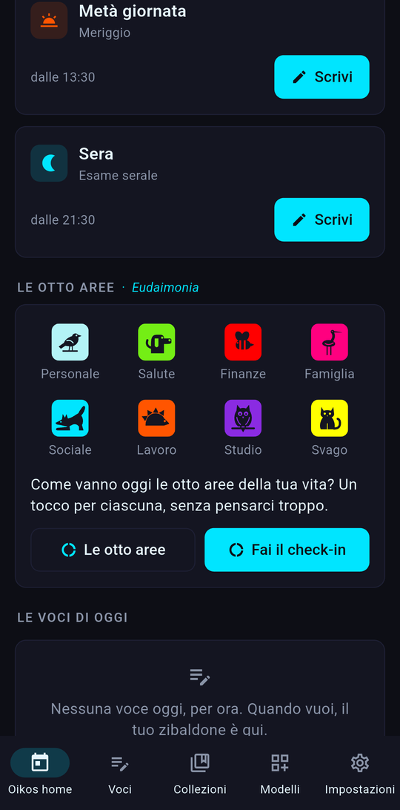
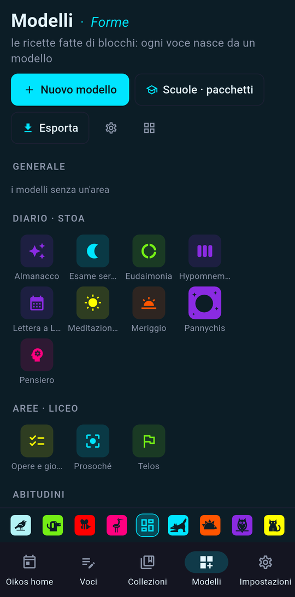
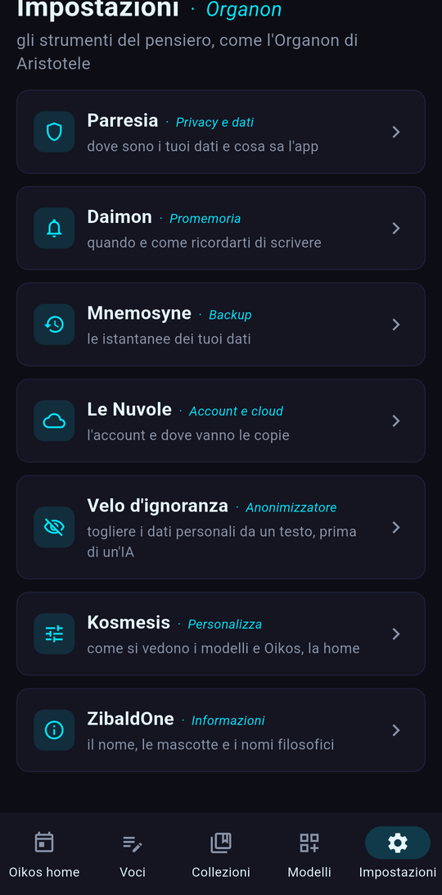

# ZibaldOne

Un "tutto in uno" personale per Windows e Android. Invece di un'app per ogni cosa (diario, spese, letture, abitudini, persone), ognuno compone i propri strumenti con modelli pronti o con blocchi, organizzati sulle 8 aree della vita: Personale, Salute, Finanze, Famiglia, Sociale, Lavoro, Studio, Svago.

| Home | Le otto aree | Modelli | Impostazioni |
|---|---|---|---|
|  |  |  |  |

## Come funziona
- **Local-first.** I dati restano sul dispositivo, in SQLite. Nessuna telemetria e nessun server: chi sviluppa l'app non riceve dati degli utenti.
- **Backup cifrati.** Istantanee che si elencano e si ripristinano come i commit di git, cifrate con AES-256-GCM (libreria `cryptography`) prima di uscire dal dispositivo, anche verso Google Drive.
- **Blocchi segreti.** Diario segreto, documenti e note mediche sono cifrati anche sul dispositivo e non entrano mai nella ricerca o nell'IA. Anche ogni importo delle finanze è cifrato.
- **Pronto per l'IA, con i dati protetti.** Un anonimizzatore locale sostituisce nomi, contatti, IBAN e altri dati personali prima che un testo arrivi a un modello. Misurato su 92 frasi di prova: precisione 96,7%, richiamo 95,6%.
- **Un solo codice.** Python con Flet per l'interfaccia su Windows e Android, più una riga di comando (`zbone`) che usa lo stesso cuore dell'app.

## Come è fatto
L'ho ideata e progettata e ne dirigo lo sviluppo, scritto con l'assistenza di LLM. Scelte, decisioni architetturali, test e verifiche sono miei: circa 30.000 righe di Python, 603 test, 30 release e 13 [decisioni architetturali](ZibaldOne/docs/decisioni/) documentate, con integrazione continua su GitHub Actions.

## Dove trovare cosa
- [Codice, avvio rapido e documentazione](ZibaldOne/README.md)
- [Release](https://github.com/KsandarIV/ZibaldOne/releases) con l'APK per Android
- [Privacy e sicurezza](ZibaldOne/docs/tecnica/privacy-e-sicurezza.md)

Autore: **Aleksandar Savov** · [Portfolio](https://ksandariv.github.io)
